<a href="https://lakred.it">
  <picture>
    <source media="(prefers-color-scheme: dark)" srcset="assets/header-dark.svg">
    <source media="(prefers-color-scheme: light)" srcset="assets/header-light.svg">
    
  </picture>
</a>

<p>
  <a href="https://lakred.it"><code>~/lakred.it</code></a> ·
  <a href="https://www.linkedin.com/in/lakred/"><code>linkedin</code></a> ·
  <a href="mailto:mlakred@outlook.it"><code>mail</code></a>
</p>

### `01.` about

Passionate about computing since I was young, I built my technical background through the ITS Cloud Developer program and several industry roles.

At **EMC Gems** I work on full-stack development with Angular and Blazor/.NET and on cloud architecture for smart-sensor systems. In my spare time I build **PienoFVG**, a fuel price comparison platform.

### `02.` experience

| Role | Company | When |
| --- | --- | --- |
| **Cloud & Full-stack Software Engineer** | EMC Gems | `Sep 2025 – present` |
| **Software Engineer .NET** | Rhenus Logistics | `Jul – Aug 2025` |
| **Full-stack Software Engineer .NET** | beanTech | `Feb – Apr 2025` |
| **Software Engineer .NET** | beanTech | `Jun – Aug 2024` |
| **Oracle APEX Developer** | beanTech | `Sep – Oct 2023` |
| **Backend Software Engineer C#/.NET** | Gruppo Euris | `May – Jun 2023` |

🎓 Higher Technical Diploma – Cloud Developer, **ITS Alto Adriatico** `2023 – 2025`

### `03.` projects

| Project | What it does | Stack |
| --- | --- | --- |
| [**PienoFVG**](https://pienofvg.lakred.com/) | Compares petrol and diesel prices between Italy and Slovenia in real time, with the real net saving. Web app, iOS app and native CarPlay. | `.NET` `Blazor` `Azure` `Microservices` |
| [**SOSInternet**](https://github.com/lakred/SOSInternet) | Monitors the internet connection and restarts the router when an outage is detected. | `.NET` `C#` |

### `04.` stack

```ts
const stack = {
  languages:     ['C#', 'JavaScript', 'Python', 'HTML/CSS', 'SQL'],
  frameworks:    ['.NET', 'ASP.NET MVC', 'Web API', 'Entity Framework', 'Blazor', 'Angular'],
  databases:     ['SQL Server', 'PostgreSQL', 'MongoDB'],
  cloudDevOps:   ['Azure', 'AWS', 'Docker', 'Kubernetes', 'Azure DevOps', 'Git'],
  methodologies: ['Agile/Scrum', 'SOLID', 'REST', 'Design Patterns', 'TDD/BDD'],
};
```

### `05.` contact

Questions, ideas, or just want to talk .NET and cloud? → [mlakred@outlook.it](mailto:mlakred@outlook.it)
